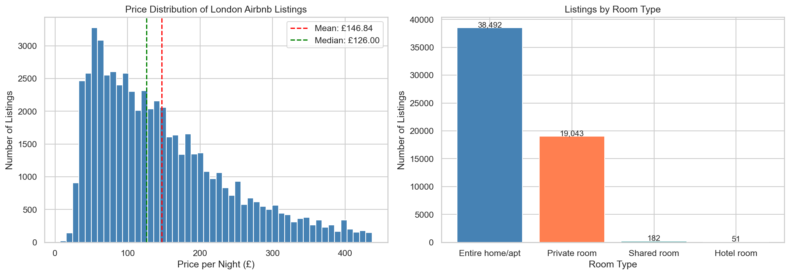
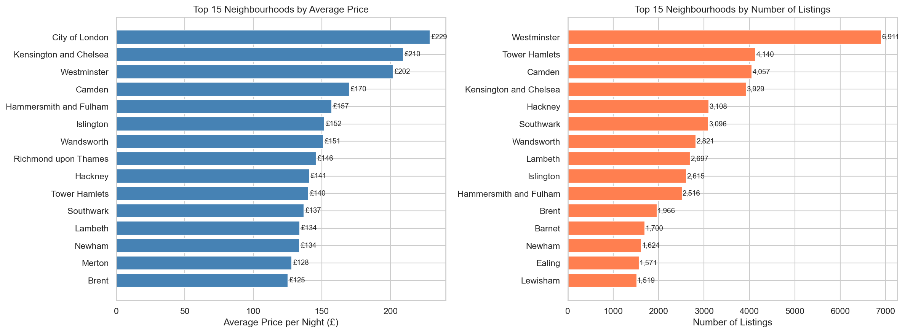
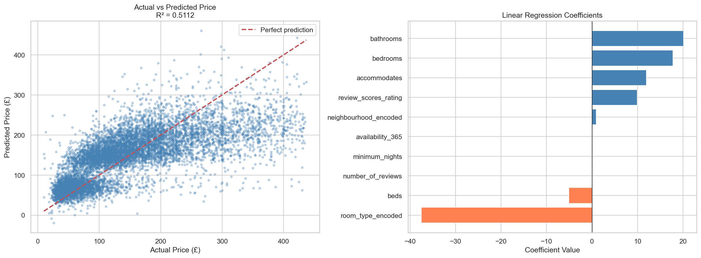

# London Airbnb: Pricing and Availability Analysis

Exploratory data analysis and machine learning on **96,871 London Airbnb listings** from Inside Airbnb, built in Python. It was my final-year individual project (605IT) for the BSc (Hons) Computing Science at Coventry University.

**Tools:** Python · pandas · NumPy · matplotlib · seaborn · scikit-learn · Jupyter

## Key findings

| | |
|---|---|
| **Entire homes vs private rooms** | Entire homes average **£184/night** against **£74** for private rooms (about 2.5×), and make up 67% of listings |
| **Most expensive area** | City of London averages **£229/night**, followed by Kensington and Chelsea (£210) and Westminster (£202) |
| **Biggest single price driver** | Guest capacity (`accommodates`, r = 0.57); review scores barely affect price (r = 0.04) |
| **Superhosts** | Charge about 5% more than regular hosts (£153 vs £145) |
| **Room-type classifier** | Random Forest predicts room type with **91.1% accuracy** |
| **Price model** | Linear regression explains about half of price variation (**R² = 0.51**, mean absolute error **£46**) |




## What I did

1. **Loaded** three datasets: listings (96,871 × 79), calendar (35.4M rows) and reviews (2.1M rows).
2. **Cleaned** the listings. I dropped columns that were mostly empty or not useful, filled missing values with sensible defaults (medians for beds and bathrooms, "unknown" for text fields) and converted prices from text such as `"$1,200.00"` to numbers.
3. **Removed price outliers** with the IQR method (upper limit £437), leaving 57,768 listings.
4. **Explored** prices by room type, neighbourhood, host status and reviews, with correlation heatmaps and distributions.
5. **Modelled**:
   - a Random Forest classifier for room type (91.1% accuracy)
   - a linear regression for nightly price (R² = 0.51)
   - a Random Forest for whether a calendar day is booked, using engineered date features (season, month, weekend). It reached about 57–59% accuracy, only a little better than guessing, which shows date features alone don't predict bookings well.



## Repository structure

```
notebooks/airbnb-eda.ipynb      Full analysis, with outputs
images/                         Charts exported from the notebook
presentation/                   Viva presentation slides
```

## Run it yourself

1. Download `listings.csv.gz`, `calendar.csv.gz` and `reviews.csv.gz` for London from [Inside Airbnb](https://insideairbnb.com/get-the-data/), unzip them, and put them in `notebooks/data/`.
2. Install the requirements and open the notebook:

```bash
pip install -r requirements.txt
jupyter notebook notebooks/airbnb-eda.ipynb
```

The raw data isn't in this repo because the files are large and Inside Airbnb publishes them under its own licence.

## Contact

Balihar Singh Sohal · [LinkedIn](https://www.linkedin.com/in/balihar-singh-sohal-88143a2a4/)
